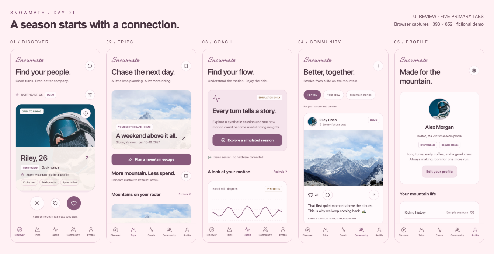

# Snowmate · Day 1 UI 审阅包

当前阶段：**审批前的可导航 UI 原型**。尚未进入真实匹配、持久化、Supabase 登录、AI、价格源或传感器功能实施。

根据你最新的设计要求，当前版本使用**淡粉底图、梅紫操作色、Snowmate 花体标识**，并保留山景和单板滑雪元素。它替代最初的深蓝方案。此设计尚未视为获批。



## 1. 已实现页面

31 个产品路由，外加 1 个组件/状态展示页。注册与登录在同一路由切换；不是两个独立后端功能。

| 模块 | 屏幕及路由 |
|---|---|
| 引导 | Welcome `/welcome`；Sign In / Sign Up `/sign-in`；Snowboarding Profile Setup `/setup`；Riding Preferences `/preferences` |
| 发现 | Swipe Discovery `/discover`；Rider Detail `/discover/rider`；Sample Match `/discover/match`；Matches `/discover/matches`；Chat `/discover/chat` |
| 行程 | Trip Home `/trips`；Planner `/trips/planner`；Results `/trips/results`；Trip Detail `/trips/detail`；Resort Detail `/trips/resort` |
| 票价 | Comparison `/prices/compare`；Offer Detail `/prices/offer` |
| 教练 | Dashboard `/coach`；Start `/coach/start`；Motion Preview `/coach/live`；Summary `/coach/summary`；Analysis `/coach/analysis`；Recommendations `/coach/recommendations`；History `/coach/history` |
| 社区 | Feed `/community`；Post Detail `/community/post`；Create Post `/community/create` |
| 我的 | Profile `/profile`；Edit `/profile/edit`；Riding History `/profile/history`；Settings `/profile/settings`；Saved Trips `/profile/saved-trips` |
| 组件状态 | `/profile/components`，也可从 Settings 进入：按钮、禁用、成功、加载、空、错误和重试状态 |

完整清单另见 `routes.json`。按钮和触摸拖拽都有视觉反馈，所有页面均有代表性内容。部分输入仅改变当前屏幕状态；实际效果以页面说明为准。

## 2. 实际生成的截图

共 **19 张 PNG**。均由本机浏览器实际运行 Expo Web 后捕获，**不是 iOS 模拟器或 iPhone 截图**。五个标签及主要屏幕为 393×852 视口；浏览器检查还覆盖 375×812。未伪造状态栏、安全区域或原生运行证明。

| 范围 | 文件 |
|---|---|
| 五标签总览 | [00-overview.png](00-overview.png)，由以下五张真实截图组合为浏览器审阅页后截图 |
| 五个主标签 | [发现](01-discover.png)、[行程](02-trips.png)、[教练](03-coach.png)、[社区](04-community.png)、[我的](05-profile.png) |
| 全部引导 | [欢迎](06-welcome.png)、[登录/注册](07-auth.png)、[资料设置](08-profile-setup.png)、[偏好](09-preferences.png) |
| 社交关键页 | [滑行者详情](10-rider-profile.png)、[示例匹配庆祝](11-match-modal.png) |
| 其他关键页 | [行程表单](12-trip-planner.png)、[票价比较](13-price-comparison.png)、[运动预览](14-motion-preview.png)、[行程详情](15-trip-detail.png) |
| 便于阅读的加高视口 | [完整表单](16-trip-planner-expanded.png)、[完整票价](17-prices-expanded.png)、[完整行程](18-itinerary-expanded.png)，393×2200，仅用于阅读内容，不代表手机实际屏幕高度 |

`11-match-modal.png` 是匹配庆祝内容的网页捕获；原生导航已配置 modal presentation，但原生弹出效果尚未在 iPhone 上验证。

重生成：先运行本地 Expo Web，再执行：

```sh
PLAYWRIGHT_BROWSERS_PATH="$PWD/.local/browsers" pnpm test:ui
PLAYWRIGHT_BROWSERS_PATH="$PWD/.local/browsers" node scripts/capture-review.cjs
```

首次需 `PLAYWRIGHT_BROWSERS_PATH="$PWD/.local/browsers" pnpm exec playwright install chromium`。本机精简 headless-shell 有 GPU/ICU 崩溃，脚本已明确使用完整 Chromium 通道。

## 3. 建议审阅路径

1. Welcome → Explore the demo → Discover；也可以先预览登录、资料和偏好。
2. 拖拽卡片或点击 Pass/Like → 详情/示例匹配 → Say hello → 临时聊天；Like 只打开样例，不代表真实互赞。
3. Trips → Plan a mountain escape → 修改输入 → 固定结果 → 行程详情 → 活动编辑、收藏、手动分享。
4. Trips 的票券按钮 → 虚构报价比较 → 明确标注未验证的 Offer；没有购买能力。
5. Coach → 模拟开始页 → 固定图表示意 → 暂停/断连状态 → 总结、分析、练习建议、历史。
6. Community → 贴文/临时评论 → 创建贴文预览；不会上传或发布。
7. Profile → 编辑姓名、站姿、级别 → Settings / Privacy preview → 状态组件展示。

底部五标签：Discover、Trips、Coach、Community、Profile。票价比较在 Trips 内，个人设置在 Profile 内。详情有返回键，直接打开详情也能退回 Discover。

## 4. 设计与组件

淡粉 `#FFF1F4` 画布，暖白 `#FFFAFC` 卡片，梅紫 `#885A7C` 操作色，深梅灰 `#493541` 正文。Snowmate 标识使用随包附带的 Allura 花体字体（SIL OFL 1.1），正文使用系统字体。

共享组件：AppButton、AppText、AppCard、ScreenContainer、PageHeader、Avatar、Badge、Chip、ChoiceGroup、Field、IconButton、HeroCard、PriceCard、MotionChart、SectionHeader、InfoRow、EmptyState、LoadingState、ErrorState、BottomSheet、PrototypeNote、通知条。Rider 卡片和 Match 庆祝视图当前属于社交模块，没有为命名而拆成无用抽象。

详细规范见 [设计系统](../../DESIGN_SYSTEM.md)，素材与字体来源见 [授权说明](../../../../apps/mobile/assets/ATTRIBUTION.md)。

## 5. 已知视觉限制与待人工验证

- 本机没有完整 Xcode、Simulator，也没有连接可用的 iPhone；安全区域、原生 modal、VoiceOver、原生键盘遮挡、最大 Dynamic Type、分享面板和真机流畅性仍待检查。
- 图片为通用可替换库存素材，不是 Stowe/Sugarbush 的实景证明。多个虚构成员复用同一头像，匹配庆祝也复用头像，正式素材需替换。
- 界面为英文候选文案，尚无中英切换。你我沟通及本审阅包使用中文。
- 长页面需要滚动；加高视口截图仅帮助看全表单，不表示所有控件能同时放入 iPhone 首屏。
- 淡粉方案已实现；没有另行制作深色主题。减少动态效果设置已接入，但硬件端体验仍需验证。
- 辅助标签与正文已做区分；照片裁切、不同屏幕亮度和最大字号下的可读性仍需人工审阅，没有声称无障碍认证。
- 地图、真实图像选择器、原生日历、动态运动曲线和真正 AI 输出尚未实现；对应入口明确说明预览状态。

## 6. iPhone 启动与人工截图

在仓库根目录执行：

```sh
pnpm install --frozen-lockfile
pnpm start
```

电脑和 iPhone 同一 Wi-Fi；手机安装支持 **Expo SDK 58** 的 Expo Go，用相机扫描终端二维码。首次进入点 **Explore the demo**。不需要密钥、登录、蓝牙硬件或定位授权。如果手机端 Expo Go 与 SDK 不匹配，先确认可用的 SDK 58 客户端或由完整 Xcode 构建 development client，再做真机测试；不要直接降级依赖掩盖兼容问题。

此机器缺 Xcode，不能在此运行 `pnpm ios` 的模拟器流程。网页可用 `pnpm web` 并访问 [本地预览](http://localhost:8081)。这不是公网部署。

人工截图步骤：按上述路径打开五标签、Welcome、滑卡、匹配庆祝、Planner、Prices、Coach、Profile；待画面稳定，用 iPhone **侧边键 + 音量加**截图；将原始文件分别存为 `iphone-01-discover.png` 等到本目录，同时记录机型、iOS/Expo Go 版本、字体大小、是否启用减少动态效果。没有实际截图前，不将 `iphone-*` 标记为存在或测试通过。

## 7. 工程与验证状态

工作分支 `codex/day1-ui-foundation`；远端 `https://github.com/lmy666888/snow-mate`。远端最初为空，已设 origin，**未推送、未部署**。

架构：pnpm workspace、Expo Router、严格 TypeScript、按域组织的 UI、Zustand 临时状态、QueryClient provider、共享契约、设计令牌、11 表本地迁移和 RLS 测试。未创建额外后端服务。依赖和精确版本见根/移动端 package.json 与 pnpm-lock.yaml。

最终命令、结果、平台限制见 [验证记录](../../../testing/DAY1_VERIFICATION.md)。Web 和 iOS JS bundle 导出不等于 iOS 原生构建，也不等于真机运行。

| 模块 | UI 状态 | 功能状态 | 后端 | iPhone / 生产 |
|---|---|---|---|---|
| 登录/引导 | UI Complete，待批准 | 跳过、表单和偏好预览 | 未集成 | 未测试 / 非生产 |
| 社交 | UI Complete，待批准 | 触摸滑卡、样例匹配、临时聊天；无持久互赞 | 本地 SQL 权限验证，App 未接入 | 未测试 / 非生产 |
| 行程 | UI Complete，待批准 | 输入、固定结果、临时编辑/收藏；手动分享 | 无 AI、无保存服务 | 未测试 / 非生产 |
| 票价/雪场 | UI Complete，待批准 | 固定虚构报价和描述，不可购买 | 无价格/实时雪况源 | 未测试 / 非生产 |
| 教练 | UI Complete，待批准 | 固定合成图表、状态控件、预写建议 | 无传感器、无 AI 分析 | 未测试 / 非生产 |
| 社区 | UI Complete，待批准 | 临时点赞/评论和发布确认预览 | 不上传、不发布 | 未测试 / 非生产 |
| 我的/设置 | UI Complete，待批准 | 姓名/站姿/级别/收藏在内存保留，刷新重置 | 无账号与云端资料 | 未测试 / 非生产 |

这里的 UI Complete 只代表审阅候选已覆盖，不代表 Demo Functional、Backend Integrated、Tested on iPhone 或 Production Ready。

## 8. 审批关卡

根据主提示第 10 节，在此停止业务功能实现，不将本轮“改成淡粉和花体”的要求理解为完整 UI 批准。

请审阅并明确回复 **批准 UI** 或提出修改，重点包括：视觉风格、布局、导航、字体、卡片、动画、整体体验。明确批准后，下一步才按主提示顺序实施 Demo Social → Auth foundation → 有校验/日历/草稿的 Trip Planner → 确定性 MockMotionProvider。

Day 2 仍不会自动启动。其依赖为：Supabase 开发环境、AI 模型与费用限制、合法票价数据源、运动数据契约与验证集、以及 iPhone 设备测试。详见 [集成前置条件](../../../api/INTEGRATION_CONTRACTS.md)。
