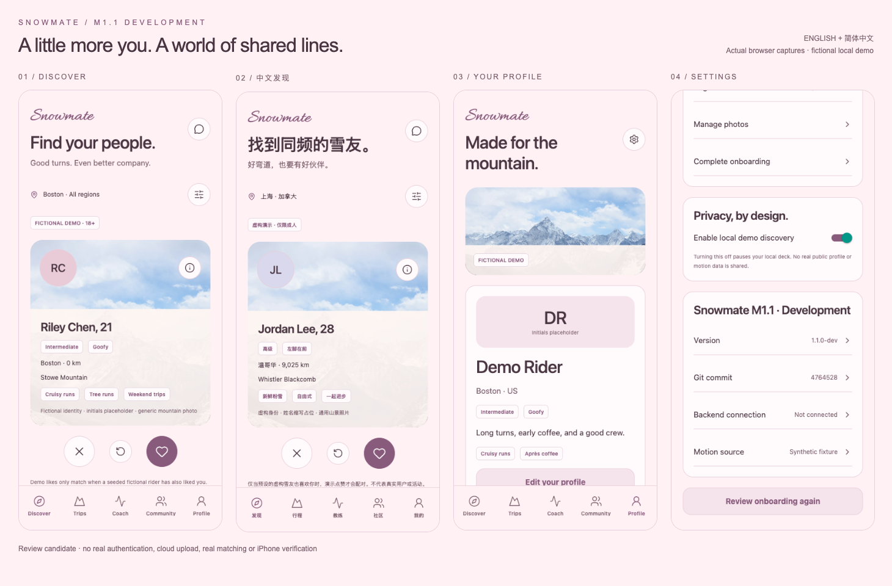

# Snowmate M1.1 · UI / 功能审阅

本轮保留淡粉底色、梅紫强调色、Allura 花体 Snowmate，重点将发现、身份与资料从临时 UI 变为可测试的本机演示。**待 owner 审批，不合并、不打最终标签、不发布。**

## 实际截图

这些是运行中的 Expo Web 在移动视口的实际捕获，不是 iPhone/Simulator 截图。常规视口 393×852；额外加高视口用于阅读完整内容，不代表实际手机高度。全部使用虚构资料、姓名缩写占位和仓库已授权库存素材，未读取个人相册。

| 内容 | 截图 |
|---|---|
| English Discover | [01](01-discover-en.png) |
| 中文发现 | [02](02-discover-zh.png) |
| 地区/单位/币种 | [03](03-region-zh.png)、[完整区域设置](14-region-expanded.png) |
| 七步引导 | [账号模式](04-onboarding-account.png)、[第七步预览](05-onboarding-preview.png) |
| 照片管理 | [06](06-photo-management.png)、[加高视口](13-photos-expanded.png) |
| 筛选 | [07](07-discovery-filters.png) |
| 双向演示配对动画静帧 | [08](08-demo-match.png) |
| 设置/版本/SHA | [09](09-settings-version.png)、[完整设置](15-settings-expanded.png) |
| 新版 Profile | [含本机照片的图库](10-profile-gallery.png)、[缩写占位](11-profile-redesign.png)、[完整页面](12-profile-expanded.png) |

Settings 的 SHA 为该截图生成时的构建 SHA；后续文档/截图提交不会反向修改已捕获图像。重启开发服务器/重新导出会获取新 HEAD。没有伪造最终提交 SHA。

## 建议验证路径

1. Welcome → Explore the demo，保留无需真实账号/照片的演示入口。
2. Settings → 简体中文；Region → 手动国家/城市、探索国家、最远距离、单位、币种；刷新确认保留，语言和地区互不修改。
3. Discover → 筛选等级/站姿/兴趣 → 卡片实际变化；看过的人不重复展示；调整距离和探索国家验证空结果。
4. 对初始 Riley 点 Like 会触发预设的双向演示配对；先 Pass 到 Jordan 再 Like 不会配对。界面明确说明虚构互赞逻辑。
5. 匹配 → 本地聊天 → 刷新后消息仍在；详情 → Block，配对/聊天移除且卡片不再出现。Undo 仅最近一次，已开始自己发消息的配对不能撤销，避免删除聊天。
6. Account preview → 第 2 步无图不可继续；添加本机照片 → 第 3 步年龄小于 18 不可继续且发现受阻 → 完成七步后可进入发现。它不是已认证真实账号。
7. Profile → 照片管理：选图、设主图、前后排序、删除、重载恢复；资料编辑后可在 Profile 查看持久变化。
8. 检查 Trips/Prices/Coach/Community：这些域仍是原先样例，中文可切换但没有新后端功能。所有票价为虚构、运动图表为合成。

## 导航变化

底部五标签保持：发现、行程、教练、社区、我的。Prices 仍在 Trips 内。新增 `/identity/onboarding`、`/profile/photos`、`/profile/region`。旧 sign-in/setup/preferences 路由转入七步身份流程；真实登录不在 M1.1 实施。

Profile 新增封面、主图、照片集、地区、简介、兴趣、雪场、风格、出行/配对偏好、训练/社区/行程入口、语言/隐私/地区/版本设置。原有返回、滚动、最小触控区域和减少动态效果继续保留。

## 设计与翻译

粉/梅紫令牌未更换；用暖白卡片和低饱和色缩写头像降低视觉重复。照片区域明确标注本机保存状态。筛选面板可滚动，选项使用可感知的 pressed 状态。

核心界面使用 en/zh 资源，运行时动态切换并在本机保留。人名、用户输入、真实的币种/协议代码不强行翻译。金额/距离/日期按 locale 格式化；价格示例仍明确 USD，不冒充实时换汇。

## 平台与限制

iPhone 未测试。原生图片选择器、权限、文件路径、原生 modal/动画、VoiceOver、最大 Dynamic Type、键盘遮挡和分享需要实际设备复核。截图是静态审阅，不能证明原生动画流畅或照片上传成功。

本地照片适配已实现，但没有云上传，可能保留 EXIF。账号预览没有真实认证/年龄核验，所有准入均为本地演示限制。生产需后端强制、元数据清理、图片安全处理和隐私/删除策略。其他域尚未实施的功能不会因界面已翻译而变成功能完成。

## 启动和重现

仓库根目录 `pnpm install --frozen-lockfile`，然后 `pnpm start`。iPhone 需要匹配 SDK 58 的 Expo Go 与同一 Wi-Fi；本机没有完整 Xcode，因此不声称已启动 iPhone。

浏览器 `pnpm web`。截图：`PLAYWRIGHT_BROWSERS_PATH="$PWD/.local/browsers" pnpm test:ui`，再在运行开发服务器时执行 `PLAYWRIGHT_BROWSERS_PATH="$PWD/.local/browsers" node scripts/capture-m1.1.cjs`。

## 审批

请审阅双语、地区选择、七步身份/照片、个人中心、筛选、配对、导航和整体体验。明确回复 **批准 M1.1** 或提出修改后，才进入相应的 PR 合并/标签流程；这次开发授权不视为发布批准。M1.2 不自动开始。
